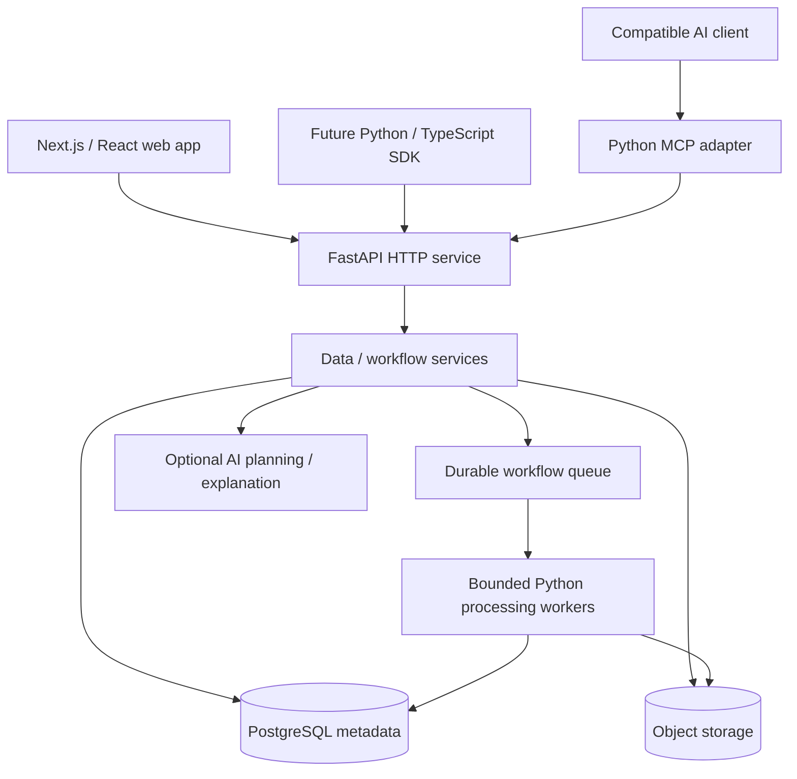

# PyFlow

**From messy data to dependable workflows.**

PyFlow is evolving from a Python CSV/JSON processing toolkit into an **AI-assisted data operations SaaS** for teams that need to clean, validate, transform, and repeat everyday data-processing tasks. The long-term platform will combine a web interface, Python execution engine, REST API, and integrations for AI agents through MCP.

> **Status: Python toolkit foundation implemented; SaaS architecture planned.** The current GitHub repository includes a CSV reader, JSON load/write utilities, a sample dataset, pytest tests, and a GitHub Actions test workflow. It does **not** yet contain a web application, FastAPI service, workflow scheduler, AI assistant, or hosted service.

[Architecture proposal](docs/ARCHITECTURE.md) · [Run the current toolkit](#run-the-current-toolkit) · [Development roadmap](#development-roadmap)

## The problem

Businesses often receive useful data in inconsistent formats: CSV reports, JSON exports, spreadsheets, and API responses. Repeated manual cleanup introduces delays, errors, and undocumented steps. General-purpose automation tools can connect systems, but teams may still lack clarity about **data quality, validation, transformation logic, and reproducibility**.

PyFlow's goal is to let a user inspect incoming data, build an approved and repeatable transformation workflow, and understand how each output was produced.

## Who is PyFlow for?

- Small businesses reconciling recurring operational reports.
- Analysts cleaning and validating CSV or JSON data.
- Operations and inventory teams receiving exports from different systems.
- Developers who want reusable Python transformations and an API.

The initial business workflow to validate is **weekly inventory/report normalization**, rather than a generic automation platform for every use case.

## Product experience — planned

1. Import a CSV or JSON file, or connect a supported source.
2. View a profile: columns, types, missing values, duplicates, and validation warnings.
3. Describe a desired outcome; AI suggests allowed transformation steps.
4. Preview changes and approve the execution plan.
5. Run the workflow in a controlled Python execution engine.
6. Inspect validation results, download outputs, and eventually schedule repeat runs.

The processing engine must work **without** AI. A model may suggest steps but will not receive unrestricted permission to execute arbitrary Python code on the server.

## Feature status

| Capability | Current repository | Planned product |
| --- | --- | --- |
| CSV input | `src/reader.py` implemented for a fixed sample schema | Configurable schemas and file limits |
| JSON input/output | `src/json_handler.py` implemented for a fixed sample schema | General validated JSON datasets |
| Validation | Required fields and numeric `Power Level` check | Profile-driven schema rules and quality reports |
| Automated tests | `tests/` with pytest | Broader unit, integration, API and end-to-end coverage |
| CI | `.github/workflows/ci.yml` runs pytest | Security, lint, type, build and deployment gates |
| Transformation engine | Not implemented | Deterministic, versioned workflow steps |
| REST API | Not implemented | FastAPI resources for datasets, workflows and runs |
| Browser app | Not implemented | React / Next.js workspace dashboard |
| AI assistance | Not implemented | Schema-aware suggestions and result explanations |
| MCP / SDK | Not implemented | Read-only exploration and approved job execution |
| Team workspaces / billing | Not implemented | Tenant isolation, roles, quotas and subscriptions |

### Current sample-data limitation

The existing readers were written against the included `data/dragon_ball_z.csv` dataset. They require fields such as `Name`, `Race`, and `Power Level`. The current code is **not** a generic CSV/JSON ingestion service yet. Making schemas configurable is a planned refactor, with tests preserving existing behavior during the transition.

## Run the current toolkit

**Requirements:** Python 3.12 is configured in the existing CI workflow. Other versions may work but are not currently asserted as supported.

```bash
git clone https://github.com/Andrez-Dev01/PyFlow.git
cd PyFlow
python -m venv .venv
```

Activate the environment:

```bash
# macOS / Linux
source .venv/bin/activate
```

```powershell
# Windows PowerShell
.venv\Scripts\Activate.ps1
```

Install the current development dependency:

```bash
python -m pip install -r requirements.txt
```

Run the existing example:

```bash
python main.py
```

This calls `load_csv("data/dragon_ball_z.csv")` and prints the parsed records; it is **not** yet an interactive CLI or SaaS server.

Run tests:

```bash
python -m pytest
```

The repository includes test files and a GitHub Actions pytest workflow. These instructions reflect existing code, but test execution was not independently verified for this README revision.

## Proposed architecture

Build a **Python modular backend with isolated background workers**, adding services only when scaling requirements justify them.



**Architecture rules:** workflows are declarative and versioned; output is reproducible; each customer has isolated permissions and storage; AI-generated suggestions require validation and appropriate user approval; all runs produce auditable status and provenance.

[Full proposed architecture, data model and security boundaries](docs/ARCHITECTURE.md).

## Proposed technology stack

| Layer | Technology | Purpose |
| --- | --- | --- |
| Processing core | Python | Input validation, transformations and reusable logic |
| API | FastAPI + Pydantic | Typed HTTP contracts and validation |
| Dataframes | Polars / PyArrow when justified | Efficient tabular operations on bounded workloads |
| Web | React, TypeScript, Next.js | Dataset previews, workflow editor and reports |
| Database | PostgreSQL | Tenants, metadata, workflows, execution status |
| Object store | S3-compatible storage | Uploaded input files and generated artifacts |
| Background jobs | Durable queue + Python workers | Scheduled or long-running processing |
| AI | Model gateway + allowlisted workflow DSL | Propose and explain safe deterministic steps |
| Developer access | REST, SDKs, MCP | Programmatic access and controlled agent tools |
| Operations | Docker, GitHub Actions, monitoring | Build, test, deploy and troubleshoot |

Only Python, standard-library CSV/JSON processing, pytest and GitHub Actions are present in today's repository. All other entries are architectural proposals.

## AI and agent integrations — planned

AI is an **assistant to human-designed automation**, not an unrestricted code execution engine. A request such as “deduplicate inventory records and standardize dates” should produce a structured plan using documented operations, followed by a preview and approval.

Early candidate MCP tools:

- `profile_dataset` — inspect metadata and validation findings.
- `suggest_transformations` — request supported transformation recommendations.
- `get_run_status` — inspect completed or in-progress jobs.
- `run_workflow` — later, an explicitly authorized and quota-bound operation.

SDK method names and API paths will be documented once working implementations exist.

## Security, data handling and reliability

The hosted product is expected to process potentially sensitive business data. Planned protections include:

- Tenant authorization for uploads, datasets, workflow versions, runs, and exports.
- File type, size, row-count, resource and execution-time limits.
- Encryption in transit and at rest, short retention, and supported deletion.
- Safe export handling (including spreadsheet formula injection protection when applicable).
- SSRF prevention for connectors and restricted network access for workers.
- No default arbitrary user-code execution or arbitrary model-generated scripts.
- Structured audit events, secret scanning, dependency reviews, and CI gates.
- Reproducible transformations with schemas, provenance, and failure reports.

These are **planned requirements**, not a claim of existing production safeguards.

## Development roadmap

- [x] **F0 — Python learning foundation:** CSV reading, JSON handling, schema checks, example dataset, pytest files, CI workflow (present in repository).
- [ ] **F1 — Reusable data models:** Replace fixed sample schema with configurable, tested dataset schemas.
- [ ] **F2 — Transformations:** Filtering, deduplication, normalization, sorting and output validation.
- [ ] **F3 — CLI/library:** Stable processing interface, package boundaries, safe errors and documentation.
- [ ] **F4 — API and persistence:** FastAPI, PostgreSQL, dataset metadata and typed contracts.
- [ ] **F5 — Workflow runner:** Versioned plans, queue, job history, object storage and safe limits.
- [ ] **F6 — Web app:** Upload, preview, transformation builder, exports and execution status.
- [ ] **F7 — AI:** Allowlisted recommendations, evaluation tests, cost and safety controls.
- [ ] **F8 — SaaS beta:** Auth, teams, data isolation, scheduling, observability and MCP.
- [ ] **F9 — Commercial validation:** Pilot users, pricing research, quotas and billing.

`[x]` means the named foundation files exist; it does not assert all tests currently pass. We will measure functionality rather than accept checklist claims as proof.

## Testing and CI

Current tests cover the readers' valid and invalid inputs. The existing `.github/workflows/ci.yml` uses Python 3.12, installs `requirements.txt`, and invokes `pytest` on pushes and pull requests. We plan to add coverage for transformations, API authorization, large/malformed uploads, workflow failures, and data-leakage prevention.

## Documentation and engineering decisions

- [Architecture proposal](docs/ARCHITECTURE.md) — design boundaries, workflow DSL and data model.
- Future: API spec, data format reference, ADRs, security threat model, contributor guide and deployment runbook.

Each significant architectural change should record the **requirement, alternatives, rationale, tests, and operational consequences** before being called production-ready.

## Contributing

Early design discussions, bug reports and focused Python improvements are welcome through GitHub issues. Please coordinate before implementing new frameworks or SaaS services so the existing toolkit is evolved rather than replaced. Contributor onboarding and a formal code of conduct can be added when external participation begins.

## License

**No LICENSE file is currently present.** Public source visibility does not grant general reuse or redistribution rights. Licensing must be decided before broad external distribution or open-source contributions.

---

**PyFlow's goal:** make routine data work understandable, repeatable, and reliable—not merely automated.
